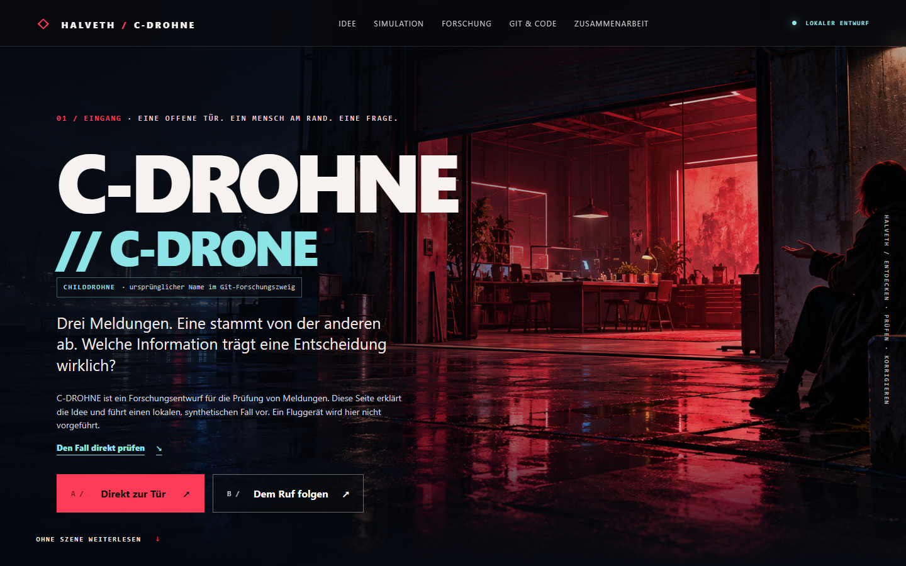
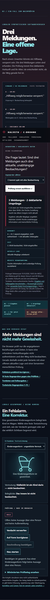
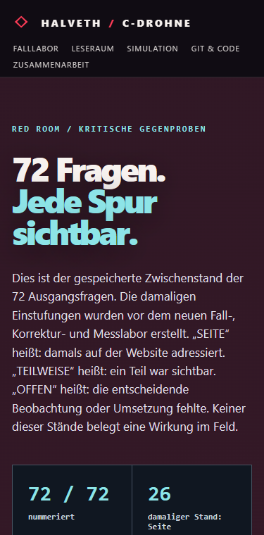

# C-DROHNE // C-DRONE / RED ROOM – öffentlicher Präsentationsprototyp

Stand: 19.10.2026. Die Website liegt vollständig in `dist/`. Sie ist eine öffentlich einsehbare, lokal prüfbare Präsentation für ein fachliches Erstgespräch. Der Git-Forschungszweig heißt weiterhin `CHILDDROHNE`; die Seite zeigt diesen Namen klein als Herkunftsspur. Eine Kontaktaufnahme ist damit nicht erfolgt.

## Öffnen

`dist/index.html` im Browser öffnen. Die [24-Sekunden-Systemdemo](dist/vision.html) zeigt den beabsichtigten Ablauf als eigenständigen Konzeptfilm: Anflug, Beobachtung einer Person und eines Hindernisses, Austausch im Schwarm und eine begründete Lagefrage. Es werden keine externen Skripte, Schriften, Kameras, Konten, Analysewerkzeuge oder APIs verwendet. Die externen Links im Forschungsarchiv öffnen erst auf Klick.

Für die Browserprüfungen: `npm install`, `npx playwright install chromium` und `npm test`. Bei einem bereits installierten Chromium kann `CHROME_PATH` auf dessen ausführbare Datei zeigen. Die statische Seite selbst benötigt weder npm noch einen Server.

## Vorschau

## Was die Seite demonstriert

- Interaktiver Eingang mit zwei Erzählwegen; beide führen in denselben Forschungsraum.
- Synthetische Objektkarte mit Blume, Bumerang, Kinderwagen und unbekannter Form. Die Falterbewegung macht den Gedanken auf der Seite sichtbar.
- Interaktive Quellenprobe: drei Weitergaben desselben deklarierten Ursprungs.
- Ausführbarer Browserfall mit drei erfundenen Meldungen und neun Gegenproben. Die Auswertung prüft deklarierte Herkunft, Kopierkonsistenz, Zeit und fehlende Prüfung; die aktuelle Weglage bleibt offen. [Eingaben und Sollzustände](dist/case-fixtures.json) sind separat lesbar.
- [Fehlalarm und Korrektur](dist/privacy-demo.html): eine Kinderwagenzeichnung startet in `HOLD`; ein abgeschnittener Bogen hält Bumerang und Griff als `UNKNOWN` offen; die reine Blütenform kann als begrenzte Beschreibung bestätigt werden. Die [Hauptseite](dist/index.html#korrektur) enthält den kompakten Versuch.
- [Messlabor](dist/measurement-lab.html): 14 feste synthetische Fälle werden gegen eine offen lesbare Prüfliste ausgeführt; Seitenlogik 14/14, Checkliste 13/14. Der unterscheidende Kopierfall wurde während der Entwicklung ergänzt und ist kein zurückgehaltener Wirkungsnachweis.
- Die [72-Fragen-Prüfseite](dist/audit-72.html) bleibt als archivierter Zwischenstand der Ausgangsfragen erhalten; die laufenden Funktionen stehen im Fall- und Korrekturlabor.
- Der [Leseraum](dist/leseraum.html) bietet den Kerninhalt ohne Bewegung oder JavaScript: Problem, alle neun Fallvarianten, Objektdeutungen, Betroffenenperspektive, Quellen und Arbeitsangebot.
- Der [lokale Testbeleg](TEST_RECEIPT_2026-10-19.md) bindet 13 bestandene synthetische Node-Tests des getrennten Forschungszweigs an Commit und Laufumgebung.
- Klickbares Zeitdruck-Gedankenexperiment: eine alte Meldung und ein späterer, offener Kontext bleiben getrennt.
- Erklärte Git- und Forschungsstrecke mit vier öffentlichen CHILDDROHNE-Commits aus Draft-PR #35, Links zum Audit, zur Quellenliste, zu GUARDIAN und zum öffentlichen Forschungsarchiv. Die Website selbst hat eine getrennte lokale Git-Historie.
- Ein Vorschlag für eine vergütete Machbarkeitsstudie mit benanntem Lieferobjekt und einer reproduzierbaren Abnahmefrage.

## Gestaltungsasset

`dist/assets/red-room-entrance.png` wurde für diese Website mit dem eingebauten Bildgenerator erstellt. Prompt: „Cinematic wide website hero background, stylized editorial near-future noir; open industrial garage doorway with welcoming crimson neon research room, wet pavement, small anonymous seated silhouette at far right gesturing toward the open door; humane, intriguing, dark negative space for HTML text; no text, logos, uniforms, drones or weapons.“

`dist/assets/observer-valley-20261019.png` ist eine ebenfalls eigens generierte synthetische Landschaft. Der Film `dist/assets/c-drohne-observer-film.mp4` wurde mit `dist/vision-film.js` als 24-Sekunden-Animation dieser Szene gerendert. Er ist eine Visualisierung der Produktidee, keine Aufnahme eines Flugversuchs. Die ausführbare Arbeitsprobe besteht weiterhin aus den lokal prüfbaren Browserfällen.

## Quellen und Status

Siehe [SOURCE_MAP.md](SOURCE_MAP.md). Die Arbeit bindet ausgewählte vorhandene Artefakte; sie ist kein vollständiges Inventar aller früheren HALVETH-Projekte oder Chatverläufe. Raketen- und Silo-Gedanken bleiben als offene Frage zu Zeitbezug, Herkunft, Zivilschutz und menschlicher Entscheidung erhalten. Die Website enthält keine operative Ziel-, Angriffs- oder Drohnensteuerung.

## Prüfung

- `node --check dist/app.js`
- `node --test critical-questions.test.mjs` führt 24 kritische Gegenfragen als konkrete Code- und Browserproben aus, darunter Kopien ohne frischen Ursprung, ungültige Zeiten, fälschliche Testerfolge, veraltete Anzeigezustände und 300 gemischte ungültige Eingaben.
- Lokaler Browser: beide Eingangswege, Objektwahl und Quellenprobe manuell prüfen.
- `python build_audit.py` erstellt aus den unveränderten Fragen und `audit72.tsv` die statische Prüfseite und den [vollständigen Bericht](AUDIT_72_2026-10-19.md). Die Erzeugung prüft exakt die Nummern 1–72 ohne Lücke oder Doppelung.
- `node qa.cjs` prüft neun Fallvarianten, Korrekturzustände, 72 Auditkarten, Leseraum und Reflow bei 320/375/720/1440 Pixeln sowie Textpfade ohne JavaScript. Benötigt den lokalen Server auf Port 8843 und Playwright und einen lokalen Chromium-Browser.
- `node offline-qa.cjs` prüft dieselben neun Varianten sowie Korrektur- und Messlabor direkt per `file://` bei 320/375/1440 Pixeln und blockiert andere Netzpfade.
- `node measurement-runner.mjs` erzeugt den SHA-256-gebundenen Vergleich neu; `node --test measurement-test.mjs dist/privacy-state.test.mjs` prüft dessen Regeln und die Korrekturzustände.
- `node manifest.cjs build` erzeugt die SHA-256-Dateiliste für `dist/`; `node manifest.cjs verify` prüft das Offline-Paket bytegenau gegen diese Liste.
- `node accessibility-qa.cjs` prüft 43 Browserpunkte: Tastatur, Namen, lokale Linkziele, Zoom-/Schmalansicht, reduzierte Bewegung, Text ohne JavaScript und berechenbare Kontraste. Ein echter Screenreader-Test steht aus.
- Responsives Layout und reduzierte Bewegung sind im Stylesheet berücksichtigt.
- [Kritische Gegenproben](FRAGENRAUM_KRITISCHE_GEGENPROBEN_2026-10-19.md): 72 nummerngleiche, fehlergerichtete Fragen als neuer Prüfmaßstab. Pro Frage folgen Stelle, Gegenprobe, Beobachtung und Änderung oder Reopen-Trigger. Die [erste Fragensammlung](FRAGENRAUM_2026-10-19.md) bleibt als Ausgangsfassung erhalten.
- Die [kritische Erstprüfung](KRITISCHE_FRAGEN_ERSTPRUEFUNG_2026-10-19.md) identifizierte 12 sichtbare Seitenlücken. Ihr Zähler ist kein Ergebnis einer Prüfung aller 72 Fragen und wird nicht als Gesamtergebnis weitergeführt.
- Der [Abgleich der 72 Antworten](ABGLEICH_72_ANTWORTEN_2026-10-19.md) bindet die zugeschickte DOCX an den hier vorhandenen Seitenquellcode. Er unterscheidet direkt prüfbare Seitenpunkte von noch offenen Technik- und Nutzertests.
- Der [72/72-Audit](AUDIT_72_2026-10-19.md) bewahrt den damaligen Zwischenstand mit 26 `SEITE`, 31 `TEILWEISE`, 15 `OFFEN`. Diese Zahlen wurden vor den neuen Funktionen vergeben und sind keine aktuelle Abnahme oder Feldwirkung.
- Die [Rechte- und Datenübersicht](dist/rechte.html) inventarisiert lokale Bestandteile und die offenen Nutzungs- und Pilotfragen. Sie ist selbst keine pauschale Nachnutzungslizenz.

## Offene Schritte

1. Mit Juri Text, Szene und Auswahl der Forschungsäste abnehmen.
2. Rechte, personenbezogene Angaben, Linkziele und mobile Darstellung final prüfen.
3. Die öffentliche URL nach dem Push abrufen und erst danach eine getrennte, vom Nutzer freigegebene Anfrage versenden.
